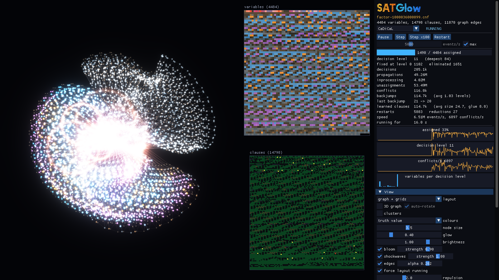
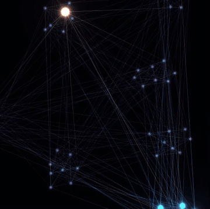
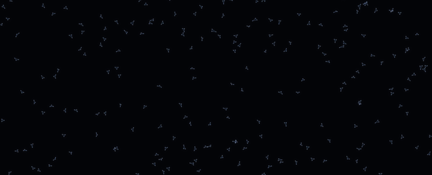
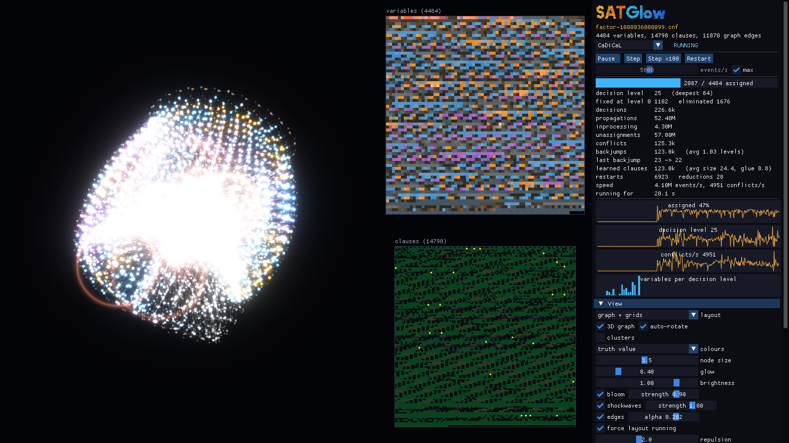
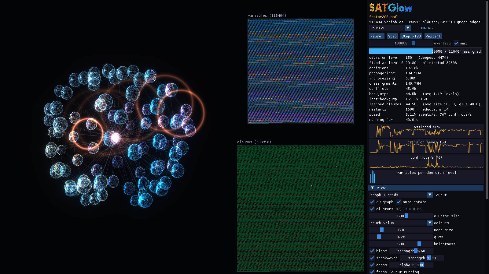

<p align="center"></p>

# SATGlow

Watch a SAT solver think.

[Demo video](https://www.youtube.com/watch?v=gsQ104doWps)

SATGlow runs a real CDCL solver (CaDiCaL, Kissat or MiniSat) on a DIMACS CNF
file and draws its state with OpenGL while it runs: which variables are
assigned, which were decisions, where conflicts happen, and how the trail
grows and collapses on every backjump. Slow the solver down to a few events
per second and single-step it, or let it run flat out and watch the light
show, in 2D or 3D.



| Conflict shockwaves | Start-up animation |
|---|---|
|  |  |

| 3D graph | 118,000 variables in 87 clusters |
|---|---|
|  |  |

New in version 3: bloom, conflict shockwaves, clustering for large
formulas, and video / GIF export. Version 2 added the 3D graph, the choice of
three solvers and the start-up animation.

---

## 1. Install the build dependencies

Target: Pop!_OS / Ubuntu 20.04 or newer (GCC 9+, CMake 3.16+, GLFW 3.3+).

```bash
sudo apt update
sudo apt install build-essential cmake libglfw3-dev libgl1-mesa-dev xz-utils python3
```

| Package | Why |
|---|---|
| `build-essential` | GCC, G++, make |
| `cmake` | build system |
| `libglfw3-dev` | window, OpenGL context, keyboard and mouse |
| `libgl1-mesa-dev` | OpenGL headers and the `libGL` link library |
| `xz-utils` | lets SATGlow open `.cnf.xz` files (SAT competition format) |
| `python3` | only for `tools/gen_cnf.py`, the instance generator |

Optional, for video and GIF export:

```bash
sudo apt install ffmpeg
```

Everything else is bundled in `third_party/` and compiled as part of the
build, so there is nothing to download:

- CaDiCaL 2.1.3, Kissat 4.0.4 and MiniSat 2.2 (each with the visualization
  hooks applied)
- Dear ImGui 1.91.9b (side panel)
- glad (OpenGL 3.3 core function loader)

### Graphics driver

SATGlow needs OpenGL 3.3 core. Check what you have:

```bash
sudo apt install mesa-utils
glxinfo | grep -E "OpenGL renderer|OpenGL core profile version"
```

On NVIDIA cards the open-source `nouveau` driver works but is slow on
GTX 10-series and newer. On Pop!_OS the vendor driver is installed with
`sudo apt install system76-driver-nvidia` followed by a reboot.

## 2. Build

```bash
cd satglow
mkdir build && cd build
cmake ..
make -j12
```

The first build takes a few minutes because it compiles three solvers. It
produces two programs in `build/`:

- `satglow` — the visualizer
- `satglow-check` — the same hooked solvers without graphics; prints the
  event counters and checks that the hooks are consistent

For the headless checker only (no display needed): `cmake -DSATGLOW_GUI=OFF ..`.

## 3. Run

From the `build/` directory:

```bash
# Tiny: follow individual assignments and backjumps
./satglow ../examples/pigeonhole-7.cnf --speed 30

# Structured, medium size; start slow, then press M for full speed
./satglow ../examples/latin-40.cnf --speed 20000

# Multiplier circuit in 3D at full speed
./satglow ../examples/factor-1000036000099.cnf --max --3d

# The same formula in another solver
./satglow ../examples/factor-1000036000099.cnf --max --solver kissat
./satglow ../examples/factor-1000036000099.cnf --max --solver minisat
```

Bundled examples (all generated by `tools/gen_cnf.py`):

| File | Variables | Clauses | Result | Notes |
|---|---|---|---|---|
| `tiny-random-60.cnf` | 60 | 256 | SAT | good for single-stepping |
| `pigeonhole-7.cnf` | 56 | 204 | UNSAT | a few thousand conflicts |
| `queens-12.cnf` | 144 | 2,620 | SAT | easy |
| `parity-34.cnf` | 100 | 266 | UNSAT | XOR chains, hard for CDCL |
| `random-250.cnf` | 250 | 1,065 | SAT | tens of thousands of conflicts |
| `latin-30.cnf` | 2,251 | 19,935 | SAT | Latin square completion |
| `latin-40.cnf` | 5,206 | 59,931 | SAT | about 50,000 conflicts |
| `factor-4294049777.cnf` | 2,820 | 9,282 | SAT | 32-bit factoring |
| `factor-1000036000099.cnf` | 4,484 | 14,798 | SAT | 40-bit factoring |

The solvers behave very differently on the same formula, which is half the
fun. On the 40-bit factoring instance, on the machine this was developed on,
Kissat needed about a second, MiniSat about half a minute and CaDiCaL about a
minute. Switch solvers with the keys `1`, `2`, `3` and compare.

### Command line

```
satglow [options] FILE.cnf[.xz|.gz|.bz2]

  --solver NAME    cadical (default), kissat or minisat
  --replay TRACE   replay a trace recorded with satglow-check --trace
  --3d             start with the graph in 3D
  --no-intro       skip the start-up animation
  --clusters       group variables into clusters (default above 20,000)
  --no-clusters    never group variables into clusters
  --no-bloom       no bloom (glow post-processing)
  --no-waves       no conflict shockwaves
  --speed N        solver events per second (assignments and unassignments)
  --max            run the solver at full speed
  --paused         start paused (SPACE resumes, S single-steps)
  --no-edges       do not draw graph edges
  --size WxH       window size (default 1600x900)
  --fullscreen     use the whole primary monitor
  --ui-scale F     scale the side panel text (default 1.0)
  --opt NAME=VAL   pass an option to the solver, e.g. --opt lucky=0
  --shot FILE.ppm  save a screenshot and exit
  --shot-after S   seconds to wait before --shot (default 5)
  --logo-svg FILE  write the SATGlow logo as an SVG file and exit
  --record FILE    record a video from the start: .mp4, .webm or .gif
  --record-seconds S  stop recording and exit after S seconds of video
  --fps N          frame rate of recordings (default 30)
```

Without `--speed` the starting speed depends on the instance size (40 events/s
for tiny formulas up to 100,000 events/s for big ones).

`--opt` names are the solver's own: any CaDiCaL or Kissat option name works
for those two. For MiniSat the supported names are `elim`, `asymm`, `rcheck`,
`luby`, `phase-saving`, `ccmin-mode`, `rfirst` and `rnd-init`.

### Keys and mouse

| Key | Action |
|---|---|
| `SPACE` | pause / resume |
| `S` | single step (one assignment or unassignment) |
| `+` / `-` | double / halve the speed |
| `M` | full speed on / off |
| `R` | restart the solver from scratch |
| `1` `2` `3` | switch to CaDiCaL / Kissat / MiniSat (restarts the search) |
| `D` | graph in 3D / 2D |
| `K` | clusters on / off |
| `B` | bloom on / off |
| `W` | conflict shockwaves on / off |
| `O` | start / stop recording a video |
| `V` | cycle layout: graph + grids, graph only, grids only |
| `C` | cycle colours: truth value, decision level, activity |
| `E` | edges on / off |
| `L` | freeze / resume the force layout |
| `F` | fit the graph to the window again |
| `P` | save a screenshot (`satglow-000.ppm`, ...) |
| `ESC` | quit |

Mouse in 2D: drag to pan, wheel to zoom. In 3D: drag to rotate, right-drag to
pan, wheel to move closer. Hover over a node or a grid pixel to see the
variable or clause behind it. Any key or click skips the start-up animation.

## 4. What you are looking at

### Graph (left)

The variable interaction graph: one node per variable, an edge between two
variables that share a clause. The layout is force-directed and keeps
improving in the background while the solver runs. With **3D graph** ticked
in the View section (or `D`) the layout inflates into three dimensions and
turns slowly; nearer nodes are bigger and brighter. Unticking it squashes the
graph flat again.

| Appearance | Meaning |
|---|---|
| dark blue-grey | unassigned |
| amber | assigned true |
| blue | assigned false |
| large and nearly white | decision variable |
| pale | fixed at decision level 0 (true for good) |
| violet fade | was just unassigned by backtracking |
| red | occurred in a recently learned clause, i.e. took part in a conflict |
| almost black | eliminated by the solver's preprocessing |

Brightness follows recent activity. At slow speeds every single assignment
flashes. At full speed the brightness is relative to the busiest variable of
the frame, so the bright and red regions show where the search is
concentrated.

### Bloom

The graph is drawn into a floating-point buffer, so light can add up beyond
white where many nodes overlap. The bright parts are blurred over a chain of
ever smaller copies and added back on top, then a soft tone curve brings the
picture to the screen without hard clipping. Turn it off with `B`, or set its
strength in the View section.

### Conflict shockwaves

Every time the solver learns a clause, a wave of orange light starts at the
clause's variables and runs outwards along the edges of the graph, one hop
at a time, while a ring expands on screen around them. A longer backjump
gives a stronger wave. At slow speeds you see every conflict; at full speed
SATGlow starts at most one wave every 0.12 s, so the waves show a sample of
where conflicts happen. Toggle with `W`.

### Clusters (large formulas)

Above 20,000 variables (or with `K` / `--clusters`) the variables are
grouped into communities with the Louvain method, and only the graph of
communities is laid out. Inside its community every variable has a fixed
place on a spiral, in breadth-first order, so neighbours sit together.
Zoomed out, a community reads as one patch of light; zoom in and its
variables appear one by one. Nodes in a crowded community are dimmed so that
it glows instead of burning white, and they get their full brightness back
as you zoom in. Edges in this mode connect communities.

The panel shows the number of communities and the modularity Q (0 to 1;
higher means more structure). Industrial and structured formulas typically
reach Q of 0.8 and more, with many clear communities. Random formulas have
no structure: they give a few huge communities and a low Q, which is an
honest picture of them. The *cluster size* slider makes the communities
bigger or smaller.

### Pixel grids (middle)

- **variables**: one pixel per variable in index order, same colours as the
  graph.
- **clauses**: one pixel per original clause. Dark green = satisfied, grey to
  orange = open (the more literals are false, the more orange), yellow = unit
  (one literal left), red = falsified (a conflict), near black = removed by
  the solver when it eliminated one of the clause's variables.

Learned clauses are not in the grid; they show up as red on the variables.

### Side panel (right)

- **Solver selector** and status, pause / step / restart, speed.
- **assigned**: current trail size, i.e. how many variables have a value.
- **decision level** and the deepest level reached.
- **fixed at level 0 / eliminated**: variables settled for good, and
  variables removed by preprocessing.
- **decisions, propagations, inprocessing, unassignments**: event counts.
- **conflicts, backjumps** with the average backjump distance in levels, and
  the last backjump (from level -> to level).
- **learned clauses** with average size and glue (LBD), **restarts**,
  **reductions** of the learned-clause database.
- Plots: assigned fraction, decision level, conflicts per second (last 20 s),
  and a histogram of how many variables sit at each decision level.
- **View**: layout, 3D, colour mode, node size, glow, brightness, edge
  opacity, and the force layout controls.

Things that may look odd but are real solver behaviour:

1. Right after the start CaDiCaL tries a few "lucky" assignments (all false,
   all true, ...): the trail fills and empties with no conflicts. Disable
   with `--opt lucky=0`.
2. Every few thousand conflicts CaDiCaL and Kissat switch to inprocessing
   (probing, vivification), which assigns variables in its own patterns.
   Kissat also starts with a preprocessing phase before the first decision.
3. After SATISFIABLE some variables change colour once more: the solver
   repairs eliminated variables when it reconstructs the full model. MiniSat
   backtracks to level 0 before it returns, so its final picture is filled in
   from the model.

### Capture

- `P` saves a screenshot (`satglow-000.ppm`, ...).
- `O` starts and stops a recording, saved as `satglow-000.mp4` (or `.gif` /
  `.webm`, chosen under *Capture* in the panel). Frames are piped into
  ffmpeg while you work; the video follows the wall clock.
- `--record FILE --record-seconds S` records from the very first frame,
  start-up animation included, and quits when done. In this mode every frame
  advances the animation by exactly 1/fps, so the video is smooth even on a
  slow machine: the window then simply runs in slow motion.

GIFs of glowing pictures get big quickly (several MB for ten seconds); use
MP4 for anything longer and convert short clips to GIF afterwards.

## 5. How it works

```
 solver thread            layout thread             render thread (60 fps)
 ─────────────            ─────────────             ──────────────────────
 solver + hooks           ForceAtlas2 +             reads both, computes
 writes per-variable  ──► Barnes-Hut, publishes ──► colours, uploads to the
 state words              node positions            GPU, draws, feeds throttle
```

- **Hooks.** `src/sg_hooks.h` is a small C header with inline functions such
  as `sg_assign`, `sg_unassign`, `sg_conflict`, `sg_backjump` and
  `sg_learned`. A solver calls them from its hot paths. Each one is a few
  plain memory writes into arrays indexed by variable; there is no queue and
  no lock, so the solver loses very little speed.
- **Solver patches.** The complete diffs against upstream are in `patches/`
  and are already applied to `third_party/`:
  - `cadical-2.1.3-satglow.patch`: hook calls in 11 files, plus a 2-line
    accessor for CaDiCaL's own counters (in `cadical.hpp` and the new
    `satglow.cpp`)
  - `kissat-4.0.4-satglow.patch`: hook calls in 12 files, plus the new
    `satglow.c` (read access to Kissat's own counters)
  - `minisat-satglow.patch`: 41 added lines in 5 files (including two small
    build fixes: no zlib needed, and a declaration newer compilers reject)
- **Throttle.** Every assignment and unassignment costs one token. The render
  thread hands out tokens at the chosen rate; at full speed the solver only
  checks the controls every 4,096 events.
- **Rendering.** OpenGL 3.3 core. Nodes are additive-blended point sprites,
  edges are indexed lines sharing the node vertex buffers, the grids are two
  textures updated every frame. One perspective camera serves both modes: in
  2D all nodes lie in a plane and the camera looks straight at it.
- **Layout.** ForceAtlas2 with Barnes-Hut repulsion (quadtree in 2D, octree
  in 3D) on up to six threads. Clauses with up to 8 variables become cliques,
  longer ones become rings.
- **Logo and intro.** `src/logo.cpp` builds the wordmark as a triangle mesh:
  every letter is a ribbon of triangles along a centre line. The intro flies
  those triangles in from a scattered cloud; the assembled state is the logo.
  `satglow --logo-svg docs/logo.svg` regenerates the vector file.
- **Bloom.** Dual-filter blur on six half-size levels with a soft threshold;
  scene and bloom are combined with a tone curve that is linear up to 0.8.
- **Shockwaves.** The hooks keep the variables of the most recent learned
  clause. A wave is a breadth-first search from them (up to 6 hops, at most
  6,000 nodes); each reached node lights up when the wave front arrives.
- **Clusters.** Louvain community detection (Blondel et al., 2008), repeated
  until no merge improves modularity; the force layout runs on the community
  graph only. 118,000 variables cluster in about 0.2 s.
- **Recording.** `glReadPixels` into an ffmpeg pipe (H.264, VP9, or GIF with
  a generated palette).

Source layout:

```
src/sg_hooks.h           hook API shared with the solvers (plain C)
src/shared.{hpp,cpp}     shared state, throttle
src/solver.{hpp,cpp}     backend interface, solver thread, model check
src/backend_*.cpp        CaDiCaL, Kissat and MiniSat backends
src/cnf.{hpp,cpp}        DIMACS parser
src/graph.{hpp,cpp}      variable interaction graph
src/layout.{hpp,cpp}     2D / 3D force-directed layout thread
src/logo.{hpp,cpp}       the wordmark as a triangle mesh, SVG export
src/intro.{hpp,cpp}      start-up animation
src/bloom.{hpp,cpp}      bloom post-processing
src/shockwave.{hpp,cpp}  conflict shockwaves
src/clusters.{hpp,cpp}   Louvain communities, positions inside clusters
src/recorder.{hpp,cpp}   video and GIF export through ffmpeg
src/trace.{hpp,cpp}      event traces: format, writer, reader, replay
src/metrics.{hpp,cpp}    search metrics from the event stream
src/backend_replay.cpp   the "solver" that replays a trace
src/metrics_main.cpp     satglow-metrics
bench/                   benchmark scripts and the SATLIB pilot set
src/main.cpp             window, camera, rendering, side panel
src/check_main.cpp       satglow-check
tools/gen_cnf.py         instance generator
```

## 6. Traces, metrics and benchmarks

```bash
./satglow-check ../examples/latin-40.cnf                       # report + self-checks
./satglow-check --solver kissat --timeout 60 FILE.cnf          # other solver, time limit
./satglow-check --trace run.sgt.zst FILE.cnf                   # record every solver event
./satglow --replay run.sgt.zst FILE.cnf                        # watch the recorded run
./satglow-check --metrics m.json --timeseries ts.csv FILE.cnf  # search metrics
./satglow-metrics run.sgt.zst FILE.cnf --metrics m.json        # same, from a trace
```

`satglow-check` prints the counters and two self-checks: the visualizer's
trail count must match the variables it shows as assigned, and for
satisfiable formulas the model must satisfy every original clause.

**Traces** hold every event the hooks saw (8 bytes each, a `.zst`, `.xz`
or `.gz` name compresses them with the matching tool). A replayed trace
looks exactly like the live run and can be slowed down, stepped and
recorded to video like one.

**Metrics** relate the search to the structure of the formula. The
variable graph is split into communities, and each learned clause is
compared with a random clause of the same size: *locality* above 1 means
learned clauses stay inside fewer communities than chance. See
`bench/README.md` for all fields.

**Benchmarks.** `bench/` has scripts that download the SAT Competition
main track, measure the overhead of the hooks against a build with the
hooks compiled out (`satglow-check-base`), check that the search is
identical, and compute the metrics; `bench/README.md` gives the full
protocol. The hooks only observe: on the 51 SATLIB pilot instances in
`bench/instances/satlib`, every hooked run of all three solvers reproduced
the conflict and decision counts of the hook-free build exactly. One
counter differs by design: SATGlow's own *decisions* counter also counts
trial assignments such as CaDiCaL's lucky phase.

## 7. More instances

```bash
../tools/gen_cnf.py random 2000 --ratio 4.2 -o r2000.cnf   # random 3-SAT
../tools/gen_cnf.py php 9 -o php9.cnf                      # pigeonhole, UNSAT
../tools/gen_cnf.py queens 30 -o q30.cnf
../tools/gen_cnf.py latin 45 --holes 0.42 -o latin45.cnf   # Latin square completion
../tools/gen_cnf.py factor 1000000016000000063 -o f60.cnf  # multiplier circuit
../tools/gen_cnf.py parity 40 -o parity40.cnf              # XOR chains, UNSAT
```

For industrial instances, download from the SAT Competition benchmark
collections. Those files are `.cnf.xz` and can be opened directly.

## 8. Known limits

- **Very large formulas.** Clustering keeps the layout fast, but every
  variable is still drawn and coloured each frame, and the community
  detection runs once when clustering is switched on. Formulas with millions
  of variables have not been tried.
- **One solver at a time.** Side-by-side runs are on the roadmap.
- **No search tree.** With restarts and non-chronological backjumping a CDCL
  run is not a tree in any useful sense, so the panel shows the trail and
  decision-level plots and the per-level histogram instead.
- **Only original clauses** appear in the clause grid.
- **Kissat:** variables that Kissat invents during preprocessing are not
  drawn, and two of its preprocessing steps (backbone extraction, transitive
  reduction) work on a scratch trail that is not shown.

## Roadmap

1. Teaching aids: narration of each event in step mode, a view of the
   implication graph behind a conflict, guided tours on small formulas,
   linked highlighting between clauses and variables.
2. Side-by-side mode: the same formula in two or three solvers at once.
3. Smaller items: PNG screenshots, Hilbert-curve ordering for the variable
   grid.

## Troubleshooting

- **"cannot create an OpenGL 3.3 core window"**: check the `glxinfo` line
  above. Over SSH or in a VM without 3D acceleration, try
  `LIBGL_ALWAYS_SOFTWARE=1 ./satglow ...` (slow, but it works).
- **Everything is too small on a HiDPI screen**: `--ui-scale 1.5`.
- **The graph is a white blob**: lower *brightness*, *glow* or the bloom
  strength in the View section, reduce *node size*, or switch edges off with
  `E`.
- **"ffmpeg not found"** when recording: `sudo apt install ffmpeg`.
- **The graph is a tiny dot or off screen**: press `F` to fit the view.
- **Solver finishes before you see anything**: lower the speed with `-` or
  start with `--paused` and step with `S`.

## Third-party code

- CaDiCaL by Armin Biere and others, MIT licence (`third_party/cadical/LICENSE`)
- Kissat by Armin Biere, MIT licence (`third_party/kissat/LICENSE`)
- MiniSat by Niklas Een and Niklas Sorensson, MIT licence (`third_party/minisat/LICENSE`)
- Dear ImGui by Omar Cornut, MIT licence (`third_party/imgui/LICENSE.txt`)
- glad loader generated by glad (David Herberth); Khronos headers under their
  own permissive licences
